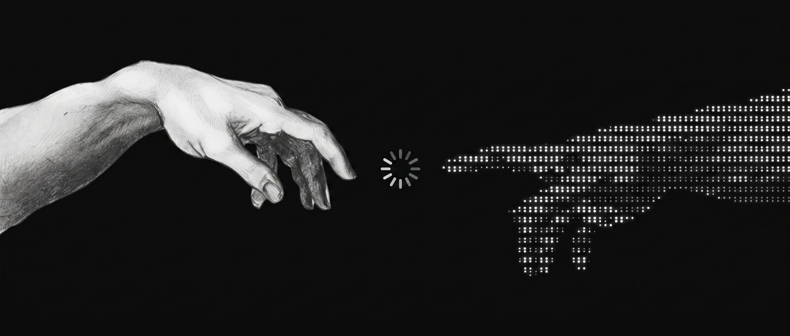
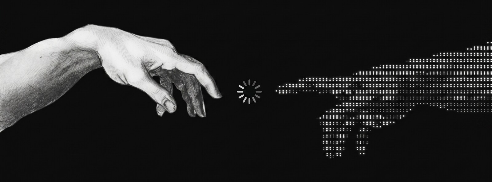
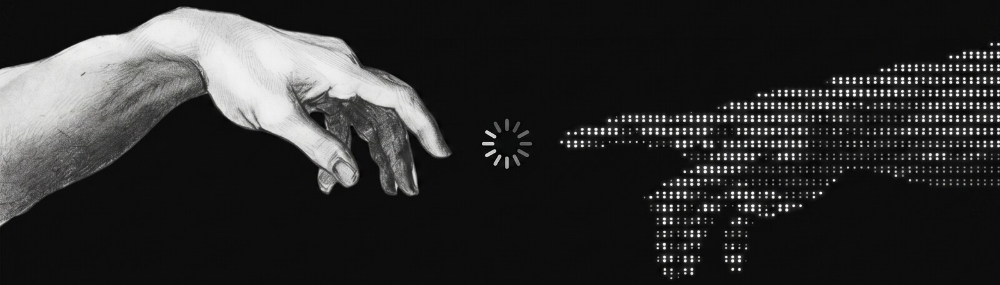
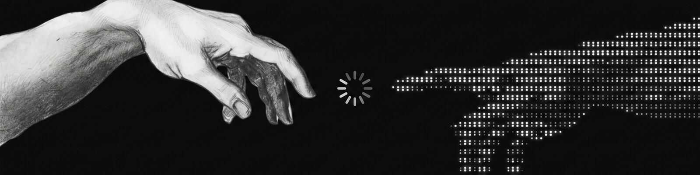

<h1 align="center">Hi 👋, I'm Eden</h1>

  

---

<!-- ================= BANNER TEST — à supprimer une fois le choix fait ================= -->

### A — 2.35 : 1 (cinémascope, le plus haut)

 

### B — 2.70 : 1

 

### C — 3.00 : 1  *(≈ nadaamd / weboko)*

 

### D — 3.50 : 1

 

### E — 4.00 : 1 (le plus fin, ultra-wide)

 

---

## Même crop (D — 3.5:1), largeurs différentes

**D1 — pleine largeur (100 %)**

 

**D2 — 720 px, centré**

 

**D3 — 560 px, centré**

 

---

## Version « propre » (ce que ça donnerait en vrai, sans les titres)

**Eden — building at the edge of AI & crypto**

<!-- ================= FIN BANNER TEST ================= -->
